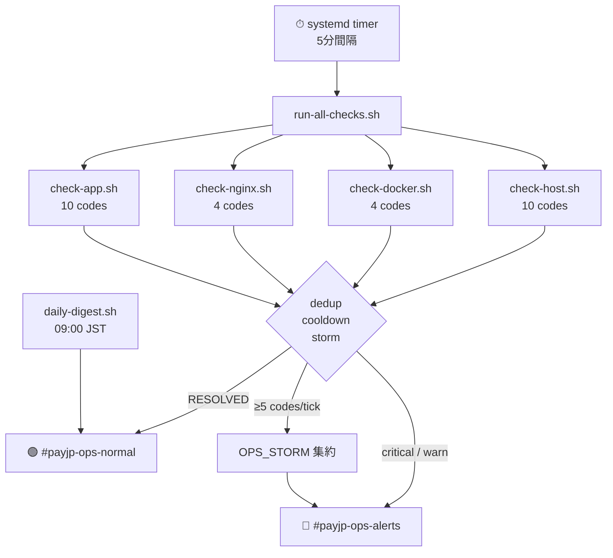
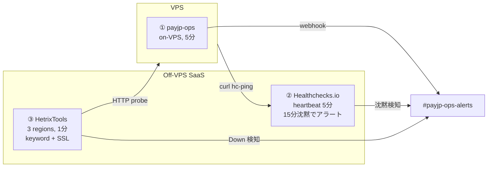
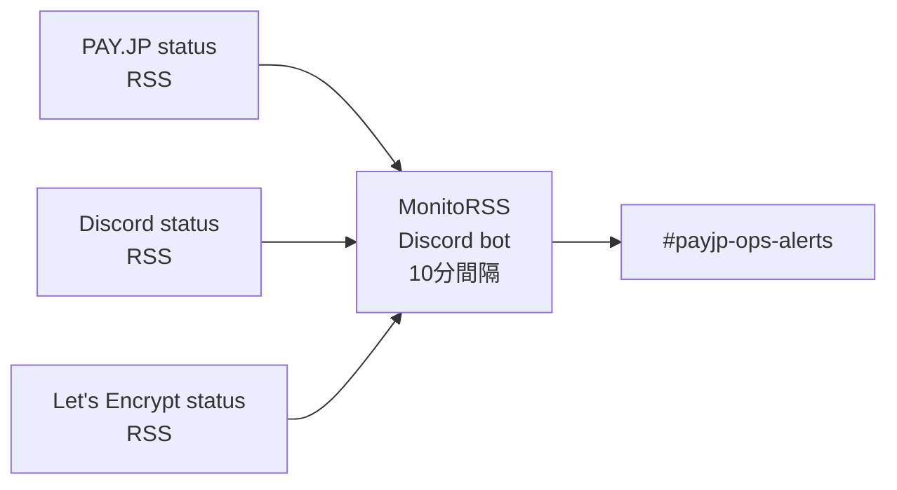
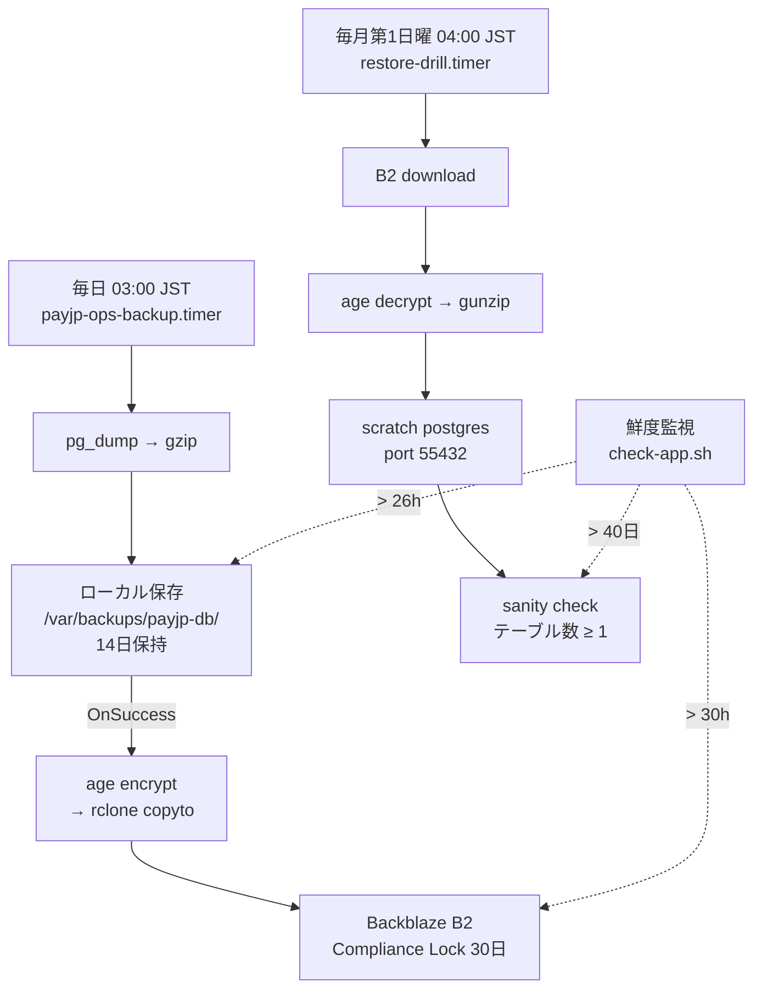

# PAY.JP × Discord Integration Service (hayane-payjp)

PAY.JP の決済状態に応じて Discord ロールを自動付与・剥奪するサブスクリプション管理サービス。

- Discord OAuth でユーザー ID を取得し、PAY.JP で課金・定期購読を管理
- Webhook と日次リシンクで決済状態と Discord ロールの整合性を維持
- 不確定障害時は `operationId` を保存し、手動 CLI で復旧

## 目次

- [システム概要](#システム概要)
- [アーキテクチャ](#アーキテクチャ)
- [ディレクトリ構成](#ディレクトリ構成)
- [技術スタック](#技術スタック)
- [データベーススキーマ](#データベーススキーマ)
- [API エンドポイント](#api-エンドポイント)
- [ビジネスロジック詳細](#ビジネスロジック詳細)
- [セキュリティ設計](#セキュリティ設計)
- [フロントエンド](#フロントエンド)
- [インフラ・デプロイ](#インフラデプロイ)
- [運用・監視](#運用監視)
- [ローカル開発](#ローカル開発)
- [仕様書](#仕様書)

---

## システム概要

SES コミュニティの有料メンバーシップを管理するシステム。ユーザーがプランを選択してクレジットカードで決済すると、Discord サーバー上の対応ロールが自動付与される。退会・決済失敗時はロールが自動剥奪される。

**ビジネスモデル:**

| プラン | 月額（税込） |
|---|---|
| Starter | ¥20,000 |
| Business | ¥50,000 |
| Enterprise | ¥70,000 |

**初回特典:** 初月は即時課金、2〜3 ヶ月目はトライアル（無料）。4 ヶ月目以降は月次自動課金。初回特典はメールアドレスごとに 1 回限り（`first_trial_granted_at` で管理）。

**要件一覧 (R1–R9):**

| ID | 要件 | 担当サービス |
|---|---|---|
| R1 | Discord OAuth (`identify` + `guilds.join`) | auth-service |
| R2 | 3 プランから選択して購読開始 | billing-service |
| R3 | 初回ユーザーのトライアル（初月課金 + 2–3 ヶ月無料） | billing-service |
| R4 | 4 ヶ月目以降の月次自動課金 | billing-service (PAY.JP 定期課金) |
| R5 | Google Form 経由の退会 → 即時完了 | billing-service |
| R6 | PAY.JP Webhook → 決済状態の DB 反映 | sync-service |
| R7 | 決済状態 → Discord ロールの同期 | sync-service |
| R8 | 日次自動リシンク + 手動 CLI による乖離修復 | sync-service |
| R9 | トラブルシュート用の構造化ログ | 全サービス |

---

## アーキテクチャ

```
┌──────────────────────────────────────────────────────┐
│                  Frontend (Vite SPA)                  │
│  プラン選択 → メール入力 → PAY.JP.js 3DS → 購読     │
│  Cloudflare Pages (www.and--line.com)                │
└────────────────────────┬─────────────────────────────┘
                         │ HTTPS (same eTLD+1)
┌────────────────────────▼─────────────────────────────┐
│              Nginx リバースプロキシ                    │
│  TLS 1.2+ / Rate Limit / Security Headers            │
│  www.and--line.com     → frontend + /v1/* → api      │
│  api.and--line.com     → webhook 専用                 │
│  admin.and--line.com   → 127.0.0.1:8443 (内部のみ)  │
└───────┬──────────────────────────┬───────────────────┘
        │ frontend network         │ admin-frontend network
┌───────▼──────────┐      ┌───────▼──────────┐
│  API Service     │      │  Admin API       │
│  (Fastify :3000) │      │  (Fastify :3011) │
│                  │      │                  │
│  auth-service    │      │  読み取り専用    │
│  billing-service │      │  会員一覧/詳細   │
│  sync-service    │      │  影響ログ        │
│  resync CLI/Cron │      │  inflight 状況   │
└───────┬──────────┘      └───────┬──────────┘
        │ backend network          │ backend network
┌───────▼──────────────────────────▼───────────────────┐
│              PostgreSQL 17 (Alpine)                   │
│  10 テーブル / pg_dump 14 日ローカル + B2 暗号化     │
└──────────────────────────────────────────────────────┘
```

**ネットワーク分離（Docker bridge）:**
- `frontend` — nginx ↔ api（公開 API）
- `admin-frontend` — nginx ↔ admin-api（api からは到達不可）
- `backend` — api / admin-api ↔ db（nginx からは到達不可）

**外部連携:**

| システム | 用途 | 認証 |
|---|---|---|
| Discord OAuth | ユーザー ID 取得 | client_id / secret |
| Discord REST API | ロール付与・剥奪 | Bot token |
| PAY.JP API | 顧客・課金・定期購読 CRUD | secret_key |
| PAY.JP Webhook | 決済イベント受信 | HMAC token |
| Google Form + Apps Script | 退会理由収集 + キャンセル実行 | HMAC 署名 |
| Let's Encrypt | TLS 証明書 | ACME |
| Cloudflare Access | Admin コンソールの認証 | Google IdP + MFA |

---

## ディレクトリ構成

```
packages/
  shared/              # 型定義、DB スキーマ (schema.sql)、共有ユーティリティ
  auth-service/        # Discord OAuth (R1) — core/ + shell/
  billing-service/     # PAY.JP 課金 (R2–R5) — core/ + shell/
  sync-service/        # Webhook + ロール同期 (R6–R8) — core/ + shell/
  server/              # Fastify HTTP サーバー + ルーティング + CLI ツール
  admin-server/        # 読み取り専用 Admin API (port 3011)
frontend/              # 購読 UI (Vite SPA)
admin-frontend/        # Admin コンソール UI
nginx/                 # nginx.conf、セキュリティヘッダー、スキャナーブロックリスト
scripts/
  ops/                 # 運用スクリプト (バックアップ、監視、通知)
  prod/                # 本番デプロイスクリプト
  local/               # ローカル開発用ヘルパー
  dev/                 # 開発時チェックスクリプト
docs/                  # 仕様書、運用手順、コンプライアンス、テスト証跡
e2e/                   # Playwright E2E テスト
```

### Pure Core / Impure Shell アーキテクチャ

各サービスは `core/`（純粋関数、I/O なし）と `shell/`（DB・API 呼び出し）に分離。

```
packages/billing-service/src/
  core/
    index.ts          # 純粋関数: planId 検証、初回判定、3DS 検証、
                      #   トライアル期間計算、HMAC 生成、Origin 検証 等
  shell/
    subscribe.ts      # I/O: PAY.JP 顧客・課金・定期購読の作成、DB 更新
    cancel.ts         # I/O: PAY.JP キャンセル、Discord ロール剥奪、DB 更新
    types.ts          # Shell 層の型定義
```

`core/` は完全に決定論的でユニットテスト可能。`shell/` は `core/` の判定結果に基づいて外部 I/O を実行する。VCSDD（Verified Contract-based Spec-Driven Development）で開発し、プロパティテストと EARS 仕様で品質を担保。

---

## 技術スタック

| カテゴリ | 技術 |
|---|---|
| 言語 | TypeScript (Node.js 22+) |
| API フレームワーク | Fastify 5.8 |
| データベース | PostgreSQL 17 |
| 決済プロバイダ | PAY.JP (`payjp` npm) |
| Discord | `@discordjs/rest` (REST API のみ、常駐 Bot なし) |
| フロントエンドビルド | Vite |
| リバースプロキシ | Nginx (Alpine) |
| コンテナ | Docker Compose |
| テスト | Vitest (ユニット/統合) + Playwright (E2E) |
| Linter/Formatter | Biome |
| Pre-commit | Lefthook |
| ワークスペース | npm workspaces（モノレポ管理） |

---

## データベーススキーマ

10 テーブル構成。DDL は [`packages/shared/src/schema.sql`](packages/shared/src/schema.sql)。

### members — 会員・購読状態の正

購読ライフサイクル全体の状態を管理する中心テーブル。

| カラム | 型 | 説明 |
|---|---|---|
| `id` | UUID PK | 会員 ID |
| `email` | TEXT UNIQUE | ログイン識別子 / provisional-member キー |
| `discord_user_id` | TEXT UNIQUE | OAuth 後にセット（NULL = 未連携） |
| `subscription_status` | TEXT | `active` / `trial` / `canceled` / `paused` / `deleted` |
| `payjp_customer_id` | TEXT UNIQUE | PAY.JP 顧客 ID |
| `payjp_subscription_id` | TEXT UNIQUE | PAY.JP 定期購読 ID |
| `payjp_initial_charge_id` | TEXT UNIQUE | 初回課金 ID（初回ユーザーのみ） |
| `payjp_plan_id` | TEXT | 現在のプラン ID |
| `access_end_at` | TIMESTAMPTZ | 現在の購読期間終了日 |
| `next_billing_at` | TIMESTAMPTZ | 次回課金日 |
| `first_trial_granted_at` | TIMESTAMPTZ | 初回特典付与日（NULL = 未付与、一度セットすると不変） |
| `cancel_requested_at` | TIMESTAMPTZ | 退会リクエスト日時 |
| `role_state` | TEXT | `granted` / `revoked` / `unknown` — Discord 同期状態 |
| `inflight_operation_id` | TEXT | 進行中の操作 ID（NULL = なし） |
| `inflight_operation_type` | TEXT | `subscribe` / `cancel` |
| `inflight_operation_started_at` | TIMESTAMPTZ | 操作開始時刻（6h 超で要手動対処） |
| `inflight_subscribe_plan_id` | TEXT | 復旧時のプラン特定用 |
| `last_payjp_event_created_at` | BIGINT | 最終処理イベントの Unix タイムスタンプ（順序逆転防止） |

### payjp_events — Webhook 受信履歴

| カラム | 型 | 説明 |
|---|---|---|
| `id` | TEXT PK | PAY.JP イベント ID（冪等性キー） |
| `event_type` | TEXT | `subscription.created` / `.updated` / `.renewed` 等 |
| `payload` | JSONB | イベント全体のペイロード |
| `process_status` | TEXT | `succeeded` / `ignored` / `failed` |
| `data_metadata_operation_id` | TEXT | メタデータの `operation_id`（追跡用） |
| `member_id` | UUID FK | 対象会員 |

### oauth_states — OAuth CSRF 防止

| カラム | 説明 |
|---|---|
| `state_hash` (TEXT UNIQUE) | SHA-256(state)。ワンタイム消費 |
| `oauth_session_hash` (TEXT) | SHA-256(`__Host-oauth_session` Cookie 値) |
| `expires_at` (TIMESTAMPTZ) | TTL 10 分 |
| `used_at` (TIMESTAMPTZ) | 消費済みタイムスタンプ |

### discord_link_sessions — OAuth 後の一時セッション

| カラム | 説明 |
|---|---|
| `link_session_token_hash` (TEXT UNIQUE) | SHA-256(`__Host-link_session` Cookie 値) |
| `discord_user_id` (TEXT) | Discord から取得したユーザー ID |
| `discord_access_token_encrypted` (TEXT) | 暗号化済み Discord アクセストークン（任意） |
| `expires_at` (TIMESTAMPTZ) | TTL 15 分 |

### cancel_form_tokens — 退会フォーム署名付きトークン

| カラム | 説明 |
|---|---|
| `id` (UUID PK) | トークン ID (= JTI) |
| `member_id` (UUID FK) | 対象会員 |
| `email` (TEXT) | 退会対象メールアドレス |
| `expires_at` (TIMESTAMPTZ) | TTL（設定値、デフォルト 15 分） |
| `used_at` (TIMESTAMPTZ) | ワンタイム消費 |

### member_sessions — 購読完了後セッション

| カラム | 説明 |
|---|---|
| `member_session_token_hash` (TEXT UNIQUE) | SHA-256(`__Host-member_session` Cookie 値) |
| `member_id` (UUID FK) | 対象会員 |
| `expires_at` (TIMESTAMPTZ) | TTL 24 時間 |

### member_impact_logs — 会員影響の追跡

未解決の問題（ロール同期失敗、inflight 長期化等）を記録し、リシンクで解消を追跡。

| カラム | 説明 |
|---|---|
| `member_id` (UUID FK) | 対象会員 |
| `issue_code` (TEXT) | `ROLE_GRANT_FAILED` / `ROLE_REVOKE_FAILED` / `INFLIGHT_STALE` 等 |
| `detail` (JSONB) | 詳細情報 |
| `operation_id` (TEXT) | 関連操作 ID |
| `resolved_at` (TIMESTAMPTZ) | 解消日時（NULL = 未解決） |

### その他テーブル

| テーブル | 用途 |
|---|---|
| `invite_tokens` | 招待 URL のワンタイムトークン |
| `invite_sessions` | 招待受理後の `__Host-invite_session` 管理 |
| `access_gate_sessions` | 共有パスコードゲートの `__Host-access_gate` 管理 |

---

## API エンドポイント

### 認証 (auth-service)

| メソッド | パス | 説明 | レート制限 |
|---|---|---|---|
| GET | `/v1/auth/discord/start` | Discord OAuth 開始。`__Host-oauth_session` Cookie 発行 | 10/分 |
| GET | `/v1/auth/discord/callback` | OAuth コールバック。code 検証 → `__Host-link_session` Cookie 発行 | 10/分 |
| GET | `/v1/auth/discord/session` | リンクセッションの有効性確認 → `{ linked: boolean }` | 15/分 |

### 課金 (billing-service)

| メソッド | パス | 説明 | 認証 | レート制限 |
|---|---|---|---|---|
| POST | `/v1/subscriptions` | 購読開始 | Origin 検証 | 5/分 |
| GET | `/v1/subscriptions/status` | 購読状態取得 | `__Host-member_session` or `__Host-link_session` | 15/分 |
| POST | `/v1/subscriptions/cancel/google-form-link` | 退会フォーム URL + 署名付きトークン生成 | `__Host-member_session` + Origin | 5/分 |
| POST | `/v1/subscriptions/cancel/google-submit` | Google Form 送信後のキャンセル実行 | `X-Cancel-Secret` + `X-Cancel-Signature` | 10/分 |
| POST | `/v1/subscriptions/cancel` | ブラウザからの直接キャンセル | `__Host-link_session` + Origin | 5/分 |

### Webhook (sync-service)

| メソッド | パス | 説明 | 認証 | レート制限 |
|---|---|---|---|---|
| POST | `/v1/payjp/webhook` | PAY.JP イベント受信・処理 | `X-Payjp-Webhook-Token` (HMAC) | 100/分 |

### アクセスゲート

| メソッド | パス | 説明 | レート制限 |
|---|---|---|---|
| GET | `/v1/access-gate/session` | ゲートの有効状態確認 | 15/分 |
| POST | `/v1/access-gate/verify` | パスコード検証 → `__Host-access_gate` Cookie 発行 | 5/分 |

### Admin API (port 3011、読み取り専用)

| メソッド | パス | 説明 |
|---|---|---|
| GET | `/admin/overview` | 統計情報（会員数、inflight 数、未解決影響ログ数） |
| GET | `/admin/members` | 会員一覧（ページネーション、検索、フィルタ） |
| GET | `/admin/members/:memberId` | 会員詳細 |
| GET | `/admin/members/:memberId/impact-logs` | 会員の影響ログ一覧 |

### ヘルスチェック

- `GET /health` → `{ status: "ok" }`

### HTTP ステータスコードのセマンティクス

| コード | 意味 | 復旧方法 |
|---|---|---|
| 200 | 正常処理（Webhook の fail-close 含む） | — |
| 401 | 認証無効（セッション / Webhook トークン） | 再認証 |
| 403 | Origin チェック失敗 | ユーザーエラー |
| 409 | ビジネス前提条件の不成立（退会済み等） | ユーザー対応 |
| 422 | 入力バリデーション失敗（3DS 未検証、不正 planId） | 正しいデータで再試行 |
| 503 | 不確定障害 or 過負荷 → `operationId` を返却 | 手動リシンク |

---

## ビジネスロジック詳細

### 1. 購読フロー (R2/R3/R4)

**エントリーポイント:** `POST /v1/subscriptions`
**実装:** `packages/billing-service/src/shell/subscribe.ts`

```
ユーザー: プラン選択 → メール入力 → カード情報入力
  ↓
PAY.JP.js: createToken(three_d_secure: true)
  ↓ 3DS iframe で本人認証
Frontend: POST /v1/subscriptions { planId, email, payjpToken, privacyConsented }
```

**バックエンド処理:**

```
1. Origin 検証 — FRONTEND_BASE_URL と完全一致 (scheme+host+port)
2. planId 検証 — 許可リスト (PAYJP_PLAN_IDS) に含まれるか
3. email で provisional member を upsert (INSERT ON CONFLICT DO NOTHING)
4. pg_advisory_lock(member_id) — 同一会員の並行操作を排他制御
5. inflight_operation_* チェック — 存在すれば 503 返却
6. payjpToken の 3DS ステータス検証 — 'verified' のみ許可 ('attempted' も拒否)
7. operationId (UUID) を生成 → inflight_operation_* に保存
   ↓ ─── PAY.JP 書き込み開始 ───
8. PAY.JP 顧客を作成 or 再利用 → payjp_customer_id を即時保存
9. 初回判定 (first_trial_granted_at === null):
   [初回] → Charge 作成 (初回金額) → Subscription 作成 (trial_end = now + 3ヶ月)
   [2回目以降] → Subscription 作成 (trial_end なし)
10. payjp_subscription_id, access_end_at, next_billing_at を保存
   ↓ ─── PAY.JP 書き込み完了 ───
11. subscription_status = 'trial' or 'active'
12. inflight_operation_* をクリア
13. __Host-member_session Cookie を発行 (TTL 24h)
```

**初回トライアルのロジック (`core/index.ts`):**
- `isFirstTimeUser()`: `first_trial_granted_at === null` なら初回
- `calculateTrialEnd()`: 現在日時 + 3 ヶ月（月末オーバーフロー対応あり: 1/31 + 3ヶ月 → 4/30）
- `first_trial_granted_at` は一度セットしたら変更不可 — メールアドレス単位で 1 回限り

**障害時の振る舞い:**
- PAY.JP 書き込み前の失敗 → inflight クリア + エラーコード返却
- PAY.JP 書き込み中のタイムアウト/5xx → **inflight を保持**、`503 + operationId` 返却
- クライアントの自動再試行は禁止（operationId で二重課金を防止）

### 2. 退会フロー (R5)

2 つのエントリーポイントがある。

#### A. Google Form 経由（推奨）

**実装:** `packages/billing-service/src/shell/cancel.ts`

```
ユーザー: 退会ボタン押下
  ↓
Frontend: POST /v1/subscriptions/cancel/google-form-link
  Cookie: __Host-member_session
  ↓
Backend:
  1. セッション検証 → member 特定
  2. HMAC-SHA256 署名付きトークン生成 (JTI + email + TTL)
  3. cancel_form_tokens テーブルに保存
  4. Google Form URL を email + token プリフィルで返却
  ↓
ユーザー: Google Form で名前・退会理由を入力して送信
  ↓
Apps Script: onFormSubmit() →
  POST /v1/subscriptions/cancel/google-submit
  Headers: X-Cancel-Secret, X-Cancel-Signature
  Body: { name, email, reason, token }
  ↓
Backend:
  1. X-Cancel-Secret 検証
  2. X-Cancel-Signature 検証: HMAC-SHA256(secret, normalizeEmail(email) + "\n" + token)
  3. cancel_form_tokens のワンタイム消費 (used_at チェック)
  4. pg_advisory_lock(member_id)
  5. PAY.JP 定期購読キャンセル API 呼び出し
  6. subscription_status = 'canceled', cancel_requested_at = now
  7. access_end_at = current_period_end (期間終了まで表示上は有効)
  8. Discord ロール剥奪 (3 回リトライ: 0s/1s/2s 待機, 各 1s タイムアウト)
  9. role_state = 'revoked'
```

#### B. ブラウザ直接キャンセル

`POST /v1/subscriptions/cancel` に `__Host-link_session` Cookie で認証。内部処理は A と同一のキャンセルロジック。

### 3. Webhook 処理 (R6)

**エントリーポイント:** `POST /v1/payjp/webhook`
**実装:** `packages/sync-service/src/shell/webhook.ts`（I/O） + `packages/sync-service/src/core/index.ts`（純粋バリデーション）

PAY.JP がイベント送信 → バリデーションチェーン → DB 更新 → ロール同期

```
受信イベント
  │
  ├─ X-Payjp-Webhook-Token 検証 (HMAC, timingSafeEqual)
  │  不一致 → 401 返却 (payjp_events に記録しない)
  │
  ├─ livemode チェック (env の PAYJP_LIVEMODE と一致するか)
  │  不一致 → ignored (理由: livemode_mismatch)
  │
  ├─ event.type 許可リスト検証
  │  許可: subscription.{created,updated,renewed,canceled,deleted,paused,resumed}
  │  範囲外 → ignored (理由: disallowed_event_type)
  │
  ├─ data.object == 'subscription' 検証
  │  不一致 → ignored (理由: invalid_data_object)
  │
  ├─ 必須フィールド検証 (event.id, type, created, data.id, data.status)
  │  欠落 → failed (理由: missing_required_fields)
  │
  ├─ 冪等性チェック (event.id が payjp_events テーブルに既存か)
  │  既存 → 200 返却 (重複、処理スキップ)
  │
  ├─ metadata.discord_user_id 整合性チェック
  │  不一致 → failed (理由: discord_user_id_mismatch)
  │
  └─ 順序逆転チェック (event.created < last_payjp_event_created_at)
     古い → ignored (理由: stale_event)
```

**DB 更新（succeeded の場合）:**
- `subscription_status` を PAY.JP のステータスに更新
- `last_payjp_event_created_at` を max(現在値, event.created) に更新
- `active`/`trial` → `access_end_at = current_period_end`
- `subscription.deleted` → ステータスを `deleted` に正規化（PAY.JP が `data.status` を省略することがある）

**設計原則:** Webhook は常に 200 を返却（トークン不一致の 401 を除く）。fail-close 設計により、バリデーション失敗も `payjp_events` テーブルに `failed`/`ignored` として記録。

**主要な pure core 関数:**
- `validateWebhookToken()` — トークン検証（定時比較を shell に委譲）
- `isAllowedEventType()` — 許可リスト判定
- `determineIgnoreReason()` — livemode/type/object の複合判定
- `validateRequiredFields()` — 必須フィールド検証
- `isEventStale()` — 順序逆転判定
- `resolveEffectiveSubscriptionStatus()` — `subscription.deleted` の正規化

### 4. ロール同期 (R7)

Webhook 処理・購読・退会の各フローから呼び出される。

**ステータス → ロールマッピング:**

| subscription_status | Discord ロール |
|---|---|
| `active` | 付与 |
| `trial` | 付与 |
| `canceled` | **即時剥奪** |
| `paused` | 剥奪 |
| `deleted` | 剥奪 |
| 不明 | 剥奪 |

**pure core 関数:**
- `shouldGrantRole(status)` — `active`/`trial` のみ `true`
- `shouldGrantPaidDiscordAccess(status, accessEndAt, now)` — `canceled` は `accessEndAt` に関係なく即時剥奪（仕様上の意図的設計）
- `resolveRoleIdForPlan(planId, mapping)` — `PAYJP_PLAN_IDS` と `DISCORD_PLAN_ROLE_IDS` の 1:1 対応で解決
- `shouldSwapRole(oldPlanId, newPlanId)` — プラン変更時の旧ロール剥奪 → 新ロール付与

**リトライポリシー:**
- 最大 3 回（0s / 1s / 2s 待機、各 1s タイムアウト）
- 全失敗時: `role_state = 'unknown'`、`member_impact_logs` に記録
- 日次リシンクで再試行

### 5. 日次リシンク/CLI (R8)

**実装:** `packages/sync-service/src/shell/daily-resync.ts`、`cli.ts`

#### 日次自動リシンク（cron）

`DAILY_RESYNC_CRON`（例: `0 2 * * *` = UTC 2:00）で起動。

- 全会員をスキャン
- `access_end_at` 超過 → `subscription_status = 'canceled'`
- PAY.JP の Subscription API で最新状態を取得 → DB 反映
- ステータス変更があればロール同期を実行
- `inflight_operation_*` は**クリアしない**（CLI のみがクリア可能）

#### 手動リシンク CLI

```bash
npm run resync -- --operation-id <operationId>   # 単一 inflight 操作の復旧
npm run resync -- --discord-user-id <discordId>  # 特定ユーザーの復旧
npm run resync -- --all                          # 全会員の完全照合
```

**出力:** JSON 形式 `{ mode, target, processed_count, succeeded_count, failed_count, started_at, finished_at, duration_ms }`
**終了コード:** `0` = 全成功、`2` = 一部失敗、`1` = CLI エラー

**pure core 関数:**
- `parseCliArgs()` — CLI 引数のバリデーション
- `buildCliResult()` — 結果 JSON の構築
- `maskSensitiveLogFields()` — ログの機密フィールドマスク

### 6. OAuth フロー (R1)

**実装:** `packages/auth-service/src/core/index.ts`（純粋）+ `shell/index.ts`（I/O）

```
1. GET /v1/auth/discord/start
   → state (crypto.randomUUID) + oauth_session 生成
   → oauth_states テーブルに state_hash + oauth_session_hash を保存
   → __Host-oauth_session Cookie 発行 (TTL 10分)
   → 302 → Discord OAuth 同意画面 (scope: identify guilds.join)

2. GET /v1/auth/discord/callback?code=XXX&state=YYY
   → state_hash と oauth_session_hash の検証 (4 条件: hash一致, session一致, 未使用, 未期限切れ)
   → Discord に code で access_token 取得
   → Discord /users/@me で discord_user_id 取得
   → discord_link_sessions に保存
   → __Host-link_session Cookie 発行 (TTL 15分)
   → 302 → フロントエンド (Cache-Control: no-store, Referrer-Policy: no-referrer)

3. GET /v1/auth/discord/session
   → __Host-link_session Cookie のハッシュで discord_link_sessions を検索
   → { linked: true/false }
```

**pure core 関数:**
- `buildDiscordAuthorizationUrl()` — OAuth URL 組み立て
- `validateOAuthStateRecord()` — state の 4 条件検証
- `validateLinkSessionRecord()` — link session の 3 条件検証
- `isExpired()` / `isUsed()` — 汎用判定

---

## セキュリティ設計

### Cookie 体系

全 Cookie は `__Host-` プレフィックスを使用し、以下の固定属性を持つ（変更不可）:

| 属性 | 値 |
|---|---|
| `Secure` | true |
| `Path` | `/` |
| `HttpOnly` | true |
| `SameSite` | `Lax` |
| `Domain` | なし（`__Host-` の制約） |

| Cookie 名 | 用途 | TTL |
|---|---|---|
| `__Host-oauth_session` | OAuth フロー中の CSRF 防止 | 10 分 |
| `__Host-link_session` | Discord 連携後の一時セッション | 15 分 |
| `__Host-member_session` | 購読完了後の認証セッション | 24 時間 |
| `__Host-access_gate` | パスコードゲート通過後 | 24 時間 |
| `__Host-invite_session` | 招待リンク受理後 | 設定値 |

### トークン保存

DB にはすべてのトークンを **SHA-256 ハッシュ** で保存。平文は Cookie にのみ存在し、JavaScript から読み取り不可（HttpOnly）。ワンタイム消費は `used_at` カラムで管理。

### 3DS 検証

- PAY.JP.js で `three_d_secure: true` を指定してトークン生成
- バックエンドで `card.three_d_secure_status === 'verified'` を検証
- `attempted`（3DS 非対応カード）も拒否
- 3DS 失敗時の自動再試行なし

### Inflight 操作の安全性

```
PAY.JP 書き込み前: operationId を DB に保存
  ↓
タイムアウト/不確定障害: inflight を保持 → 503 + operationId 返却
  ↓
自動クリア禁止: CLI による手動確認後のみクリア
  ↓
6h 超過: member_impact_logs に INFLIGHT_STALE を記録
```

### HMAC / 定時比較

| 対象 | 方式 |
|---|---|
| PAY.JP Webhook | `X-Payjp-Webhook-Token`（`timingSafeEqual` でタイミング攻撃防止） |
| Google Form 退会 | `HMAC-SHA256(secret, normalizeEmail(email) + "\n" + token)` |
| パスコードゲート | SHA-256 ダイジェスト後に `timingSafeEqual` |

### シークレット管理

- `.env*` ファイルの読み取り禁止（`Read`, `cat`, `grep` 等すべて）
- `op run --env-file=.env` 経由で Docker Compose を起動
- 起動時にシークレットの最低長を検証（Webhook トークン ≥ 16 bytes、Cancel secret ≥ 32 bytes）

### Nginx セキュリティ

- TLS 1.2+ / ECDHE 系暗号スイート / HSTS preload / OCSP Stapling
- CSP: `script-src 'self'; object-src 'none'; base-uri 'self'`
- Rate Limit: 一般 10 req/s、Webhook 30 req/s
- スキャナーブロックリスト / dotfile アクセス拒否 / CGI パス拒否
- JSON 構造化ログ（fail2ban 連携可能）

---

## フロントエンド

### 購読 UI (`frontend/src/`)

Vite SPA。TypeScript + DOM 直接操作（フレームワーク不使用）。

| ファイル | 役割 |
|---|---|
| `main.ts` | エントリーポイント、ルーティング、画面切替 |
| `api.ts` | HTTP クライアント（fetch + Cookie 自動送信） |
| `billing-ui.ts` | プラン選択、メール入力、PAY.JP.js 3DS フォーム |
| `cancel-ui.ts` | 退会フロー、Google Form リンク生成 |
| `member-entitlement.ts` | 購読状態の表示 |
| `map-subscribe-error.ts` | 購読エラーコード → ユーザー向けメッセージ変換 |
| `map-cancel-error.ts` | 退会エラーコード → ユーザー向けメッセージ変換 |
| `ui.ts` | 画面描画ロジック |
| `widgets.ts` | 再利用可能な UI 部品 |
| `error-ui.ts` | エラー表示 |

### Admin コンソール (`admin-frontend/src/`)

読み取り専用の管理画面。Cloudflare Access + Google IdP + MFA 経由でアクセス制御。

---

## インフラ・デプロイ

### Docker Compose 構成

4 サービス + 2 ボリューム + 3 ネットワーク。

| サービス | イメージ | ポート | ネットワーク |
|---|---|---|---|
| `db` | postgres:17-alpine | — (内部のみ) | backend |
| `nginx` | nginx:alpine | 80, 443, 127.0.0.1:8443 | frontend, admin-frontend |
| `api` | カスタムビルド | 3000 (expose) | frontend, backend |
| `admin-api` | カスタムビルド | 3011 (expose) | admin-frontend, backend |

**全サービス共通のハードニング:**
- `read_only: true` + `tmpfs: /tmp`
- `security_opt: no-new-privileges`
- `cap_drop: ALL`（最小限の `cap_add` のみ）
- ログ: `json-file` ドライバ（10MB × 3 ファイル）

### 本番デプロイ

```bash
op run --env-file=.env -- bash scripts/prod/deploy.sh
```

`deploy.sh` の処理: ロックファイル取得 → Git dirty チェック → ディスク容量チェック (≥ 2 GiB) → `docker compose pull && up -d` → ヘルスチェック待機 (最大 300s/サービス) → スモークテスト (`GET /health`) → Discord 通知 → ログ記録

### TLS

Let's Encrypt (certbot standalone) / TLSv1.2+1.3 / ECDHE 系暗号 / HSTS preload / OCSP Stapling

---

## 運用・監視

> 詳細: [`docs/ops/`](docs/ops/) 配下の各ドキュメント

### VPS 内部監視 (payjp-ops)

systemd timer（5 分間隔）で 4 層のチェックスクリプトを順次実行し、異常検知時は Discord webhook で即時通知。日次ダイジェストを 09:00 JST に配信。



**check-host.sh（Linux ホスト層）**

| コード | チェック | 閾値 | 重大度 |
|---|---|---|---|
| `HOST_DISK_ROOT` | `/` 使用率 | > 85% | critical |
| `HOST_DISK_VARLOG` | `/var/log` 使用率 | > 85% | warn |
| `HOST_DISK_BACKUPS` | backup 領域使用率 | > 85% | critical |
| `HOST_LOAD_HIGH` | load5 / nproc | > 2x, 3 tick 連続 | warn |
| `HOST_OOM_KILL` | OOM kill (24h) | ≥ 1 イベント | critical |
| `HOST_REBOOT_REQUIRED` | 再起動要求ファイル | 存在検知 | warn |
| `HOST_SWAP_HIGH` | swap 使用率 | > 50% | warn |
| `HOST_FAIL2BAN_SURGE` | fail2ban BAN 合計 | ≥ 10 | warn |
| `HOST_TLS_EXPIRING` | TLS 証明書残日数 | < 14 日 | critical |
| `HOST_DOMAIN_EXPIRING` | ドメイン残日数 | < 30 日 | critical |

**check-docker.sh（Docker 層）**

| コード | チェック | 閾値 | 重大度 |
|---|---|---|---|
| `DOCKER_DAEMON_DOWN` | docker daemon 状態 | != active | critical |
| `DOCKER_CONTAINER_EXITED` | compose コンテナ | exited 検知 | critical |
| `DOCKER_RESTART_DELTA` | RestartCount 差分 | 前 tick から増加 | warn |
| `DOCKER_HEALTH_UNHEALTHY` | DB healthcheck | unhealthy | critical |

**check-nginx.sh（HTTP 層）**

| コード | チェック | 閾値 | 重大度 |
|---|---|---|---|
| `NGINX_5XX_BURST` | 5xx 応答 / 5 分 | > 5 | critical |
| `NGINX_429_BURST` | 429 応答 / 5 分 | > 50 | warn |
| `NGINX_UPSTREAM_SLOW` | upstream p95 応答時間 | > 5.0s | warn |
| `NGINX_ERRLOG_CRIT` | error.log crit/alert/emerg | 新規エントリ | critical |

**check-app.sh（アプリ + DB 層）**

| コード | チェック | 閾値 | 重大度 |
|---|---|---|---|
| `APP_HEALTH_FAIL` | `/health` HTTP | != 200 or timeout 3s | critical |
| `APP_HEALTH_SLOW` | `/health` 応答時間 | > 3.0s | warn |
| `DB_PING` | `SELECT 1` | 失敗 | critical |
| `APP_PAYJP_EVENTS_FAILED` | webhook failed / 1h | > 3 | critical |
| `APP_IMPACT_LOGS_OPEN` | 未解決 impact_logs | > 5 | warn |
| `APP_INFLIGHT_STUCK_WARN` | inflight 滞留 | > 30 分 | warn |
| `APP_INFLIGHT_STUCK_CRIT` | inflight 滞留 | > 6 時間 | critical |
| `DB_BACKUP_STALE` | 最新 backup 経過時間 | > 26h | critical |
| `DB_OFFSITE_STALE` | オフサイト upload 経過時間 | > 30h | critical |
| `DB_RESTORE_DRILL_STALE` | restore drill 経過日数 | > 40 日 | critical |

**通知制御**

| 機構 | 動作 |
|---|---|
| Cooldown | critical: 10 分, warn: 30 分, normal: 60 分（コード別上書き可） |
| 復旧判定 | 2 tick 連続正常で `*_RESOLVED` を normal チャンネルに投稿 |
| Storm 抑制 | 同一 tick で 5 codes 以上発火 → 個別通知抑制 + `OPS_STORM` 集約を alerts に投稿 |
| Global rate limit | 60 秒に 1 通 |

> 詳細: [`docs/ops/alerts.md`](docs/ops/alerts.md)

### 外部からの VPS 監視（3 層 liveness）

VPS 全損・outbound 断・inbound 断をそれぞれ異なる層で検知し、相互のブラインドスポットを補完する。



| 層 | ブラインドスポット | 補完する層 |
|---|---|---|
| ① 内部 (payjp-ops) | VPS 全損・outbound NW 断 | ② HC.io が沈黙検知 |
| ② Healthchecks.io | inbound ブロック (UFW/DNS/TLS/BGP) | ③ HetrixTools が外部 probe |
| ③ HetrixTools | outbound-only 障害・内部プロセス異常 | ① 内部チェック |

> 詳細: [`docs/ops/external-monitoring.md`](docs/ops/external-monitoring.md)

### 上流ステータス監視

依存する外部サービスの障害を MonitoRSS（Discord bot）経由で RSS フィードから検知。



| フィード | URL | プラットフォーム |
|---|---|---|
| PAY.JP | `https://status.pay.jp/history.rss` | Atlassian Statuspage |
| Discord | `https://discordstatus.com/history.rss` | Atlassian Statuspage |
| Let's Encrypt | `https://letsencrypt.status.io/` | status.io |

> 詳細: [`docs/ops/external-monitoring.md`](docs/ops/external-monitoring.md)

### バックアップ・リストアパイプライン

ローカル → オフサイト → 月次復旧訓練の 3 段階で、バックアップの取得・保全・復元可能性を継続的に検証。



| 監視コード | 閾値 | 対象 |
|---|---|---|
| `DB_BACKUP_STALE` | > 26 時間 | ローカルバックアップ鮮度 |
| `DB_OFFSITE_STALE` | > 30 時間 | B2 オフサイト upload 鮮度 |
| `DB_RESTORE_DRILL_STALE` | > 40 日 | 月次 restore drill 実施 |

> 詳細: [`docs/ops/backup-restore.md`](docs/ops/backup-restore.md)

### 障害復旧 CLI

```bash
npm run resync -- --operation-id <opId>          # inflight 操作の復旧
npm run resync -- --discord-user-id <discordId>  # 特定ユーザーの復旧
npm run resync -- --all                          # 全会員の完全照合
npm run invalidate-access-gate                   # アクセスゲートセッション無効化
```

---

## ローカル開発

### 前提条件

- Node.js 22+、Docker（Docker Compose）

### 環境変数の設定

```bash
cp .env.example .env
```

全 28 変数の取得元・本番/ローカル差・`op://` 参照可否は [`docs/ops/environment-variables.md`](docs/ops/environment-variables.md) を参照。

主要な変数:

| 変数 | 取得場所 |
|---|---|
| `DISCORD_CLIENT_ID` / `DISCORD_CLIENT_SECRET` | [Discord Developer Portal](https://discord.com/developers/applications) → OAuth2 |
| `DISCORD_BOT_TOKEN` | Discord Developer Portal → Bot |
| `DISCORD_GUILD_ID` / `DISCORD_PLAN_ROLE_IDS` | Discord サーバー設定 |
| `PAYJP_SECRET_KEY` / `PAYJP_WEBHOOK_TOKEN` | [PAY.JP ダッシュボード](https://pay.jp/) |
| `PAYJP_PLAN_IDS` / `PAYJP_PLAN_INITIAL_CHARGE_AMOUNTS` | PAY.JP → 定期課金プラン |
| `VITE_PAYJP_PUBLIC_KEY` | PAY.JP → API キー → 公開鍵 |
| `GOOGLE_FORM_CANCEL_*` | Google Form の設定値 |

### Docker Compose で起動（推奨）

```bash
npm run docker:up       # op run 経由で全スタック起動 (DB マイグレーション自動)
npm run docker:down     # 停止
npm run docker:logs     # ログ追跡
```

### ローカル開発（ホットリロードあり）

```bash
# ターミナル 1: DB のみ Docker で起動
docker compose up db

# ターミナル 2: API サーバー（DB マイグレーション自動）
npm install && cd packages/server && npm run start

# ターミナル 3: フロントエンド（/v1/* を自動でポート 3000 にプロキシ）
cd frontend && npm run dev
# → http://localhost:5173
```

### 開発コマンド

```bash
# テスト
npm test                         # 全パッケージ
npm run test:billing             # billing-service のみ
npm run test:sync                # sync-service のみ
npm run test:auth                # auth-service のみ
npm run test:admin-server        # admin-server のみ

# E2E テスト
npm run e2e                      # Playwright テスト実行
npm run e2e:ui                   # Playwright UI モードで実行

# Lint / Format
npm run lint                     # Biome チェック
npm run format                   # Biome 自動修正

# ビルド
npm run build:frontend           # フロントエンドビルド
npm run build:admin-frontend     # Admin フロントエンドビルド

# セキュリティチェック
npm run check:payment-security   # 決済ページのセキュリティ検証
```

### Google Form 退会フロー設定

#### 1. Google Form の作成

項目: 氏名、メールアドレス、退会理由、トークン。メールアドレスとトークンの `entry.<id>` を `.env` に設定。

フォーム完了メッセージに `?cancel=submitted` 付きリンクを記載（例: `https://www.and--line.com/?cancel=submitted`）。

#### 2. Apps Script の作成

フォーム送信トリガーから以下を実行:

```javascript
function onFormSubmit(e) {
  const values = e.namedValues;
  const payload = {
    name: values["氏名"][0],
    email: values["メールアドレス"][0],
    reason: values["退会理由"][0],
    token: values["トークン"][0],
  };

  const url = "https://www.and--line.com/v1/subscriptions/cancel/google-submit";
  const response = UrlFetchApp.fetch(url, {
    method: "post",
    contentType: "application/json",
    headers: {
      "X-Cancel-Secret": PropertiesService.getScriptProperties()
        .getProperty("GOOGLE_FORM_CANCEL_SECRET"),
    },
    payload: JSON.stringify(payload),
    muteHttpExceptions: true,
  });
  Logger.log("google-submit HTTP " + response.getResponseCode());
}
```

#### 3. Script Properties

`GOOGLE_FORM_CANCEL_SECRET` にアプリ側 `.env` と同じ値を設定。

---

## 仕様書

| 文書 | 役割 |
|---|---|
| [`docs/2weeks-spec.md`](docs/2weeks-spec.md) | 機能仕様（Go-Live の正本） |
| [`docs/implementation-design-mvp.md`](docs/implementation-design-mvp.md) | 実装設計（API 契約、DB モデル、シーケンス） |
| [`docs/tdd-acceptance-matrix-mvp.md`](docs/tdd-acceptance-matrix-mvp.md) | TDD 受け入れ基準（T-P0-01 〜 T-P0-07） |
| [`docs/admin-console-boundary.md`](docs/admin-console-boundary.md) | 管理画面の境界（将来拡張 CR-005） |
| [`docs/ops/`](docs/ops/) | 運用手順（リシンク CLI、ロール剥奪、環境変数、本番準備チェックリスト） |
| [`docs/compliance/`](docs/compliance/) | コンプライアンス文書 |
| [`docs/evidence/`](docs/evidence/) | テスト・レビュー証跡 |
